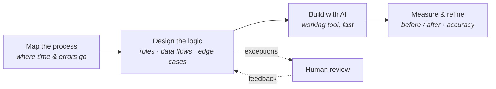

  

  
  
  

### About

I design **data and automation systems** (validation tools, control dashboards, risk models) and build them with AI.

I don't come from a computer-science background. My strength is understanding a messy process deeply, designing the logic that fixes it, and then using AI to turn that design into a working tool.

### How I work

### Featured projects

| System | What it does | Links |
|---|---|---|
| ⚖️ **Appeals Risk & Exposure Model** | Volume trends, error root causes, expected-exposure heatmap and what-if scenarios | [Live](https://jithinjolly2000-maker.github.io/appeals-risk-exposure-model/) · [Code](https://github.com/jithinjolly2000-maker/appeals-risk-exposure-model) |
| 🎛️ **Ops Control Center** | Weekly capacity vs demand, automation actuals vs plan, per-agent impact | [Live](https://jithinjolly2000-maker.github.io/ops-control-center/) · [Code](https://github.com/jithinjolly2000-maker/ops-control-center) |
| 🔄 **CSV Reconciliation Tool** | Matches two files and surfaces mismatches and one-sided rows, fully in-browser | [Live](https://jithinjolly2000-maker.github.io/csv-reconciliation-tool/) · [Code](https://github.com/jithinjolly2000-maker/csv-reconciliation-tool) |
| 🛡️ **Compliance Audit Dashboard** | Exception flagging, exposure views and drill-down | [Live](https://jithinjolly2000-maker.github.io/compliance-audit-dashboard/) · [Code](https://github.com/jithinjolly2000-maker/compliance-audit-dashboard) |
| 🧩 **Segmentation Logic Explorer** | 50+ rule codes, live rule tester and conflict/overlap checks | [Live](https://jithinjolly2000-maker.github.io/segmentation-logic-explorer/) · [Code](https://github.com/jithinjolly2000-maker/segmentation-logic-explorer) |
| 🗄️ **SQL Playground** | A real SQLite database in the browser: JOINs, CTEs and window functions all work | [Live](https://jithinjolly2000-maker.github.io/sql-playground/) · [Code](https://github.com/jithinjolly2000-maker/sql-playground) |

All demos run on synthetic data. Nothing is uploaded; your data stays on your machine.

### Toolkit

`SQL` · `PostgreSQL` · `SAS` · `Python` · `Advanced Excel / VBA` · `Power BI` · `Tableau` · `QuickSight` · `Flask` · `FastAPI` · `Node` · `Agentic AI tools`

Python and JavaScript work is AI-assisted.

### Recognition

- 🏆 Invent & Simplify Award — Amazon (Director/L8), 2026
- 🥇 Best Performer of the Month (May 2026)

### Say hi

Happy to talk data, risk and automation. See everything at **[jithinjolly2000-maker.github.io](https://jithinjolly2000-maker.github.io)**.
